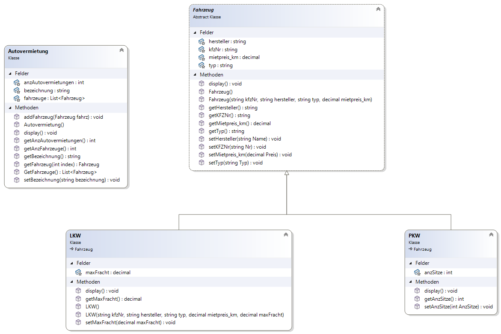

# Autovermietung (C# / WPF)

Desktop-Anwendung zur Verwaltung des Fuhrparks einer Autovermietung, entstanden in der Ausbildung zum Fachinformatiker Anwendungsentwicklung.



## Funktionen

- **Fahrzeugverwaltung:** PKW und LKW laden, hinzufügen, bearbeiten und löschen
- **Persistenz** in einer SQLite-Datenbank (`Autovermietung.db`)
- **Mietrechner:** berechnet die Mietkosten anhand des Preises pro Kilometer
- **Finanzrechner:** berechnet Raten über ein eigenes Fenster mit Datenbindung
- **Mini-Reporting:** durchschnittlicher Preis pro Kilometer, gruppiert nach Fahrzeugtyp (SQL-Aggregation)
- **Metronom:** Timer-Beispiel zur Arbeit mit ereignisgesteuerter Programmierung

## Technik und Konzepte

| Bereich        | Eingesetzt                                             |
|----------------|--------------------------------------------------------|
| Sprache        | C#                                                     |
| UI             | WPF (XAML)                                             |
| Framework      | .NET Framework 4.8                                     |
| Datenbank      | SQLite über `System.Data.SQLite` (NuGet)               |
| Architektur    | MVVM für Miet- und Finanzrechner (`INotifyPropertyChanged`, Datenbindung) |
| OOP            | abstrakte Basisklasse `Fahrzeug`, Vererbung `PKW` / `LKW`, Polymorphie |
| Datenzugriff   | eigene Service-Klasse `DbService` (Laden, Einfügen, Ändern, Löschen) |

## Projektstruktur

```
Model/            Fachklassen (Fahrzeug, PKW, LKW, Autovermietung) und DbService
Mietrechner/      View + ViewModel (MVVM)
Finanzrechner/    View + ViewModel (MVVM)
MainWindow.xaml   Hauptfenster mit Fahrzeugliste
Mini-Reporting    Auswertung nach Fahrzeugtyp
Autovermietung.cd Klassendiagramm (Visual Studio)
```

## Starten

1. `WPFAutovermietung.sln` in Visual Studio oder Rider öffnen
2. NuGet-Pakete wiederherstellen (passiert beim ersten Build automatisch)
3. Projekt starten – die Beispieldatenbank `Autovermietung.db` liegt bei
